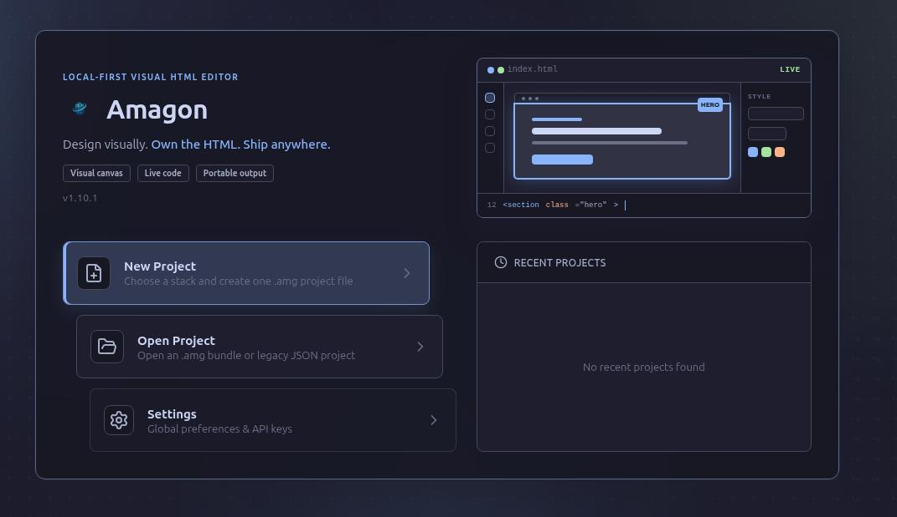

# Amagon HTML Editor

<p align="center">
  
</p>

Amagon is an offline desktop HTML editor for building block-based pages visually, then dropping to raw code when you need it.

[amagon.app](https://amagon.app)



## Features

- **AI assistant**: Generate blocks from plain-language prompts, work with multiple providers, and review AI edits in a Monaco diff before applying them.
- **Visual editing**: Build pages with drag and drop, inline text editing, reusable blocks, and responsive preview modes.
- **Code integration**: Switch to Monaco at any time and keep the visual canvas and HTML in sync in both directions.
- **Theme system**: Edit colors, typography, spacing, borders, and custom CSS from one place, backed by CSS variables.
- **Publish to web**: Publish directly to GitHub Pages, Cloudflare Pages, Neocities, or AWS S3, or add your own provider through `PublisherExtension`.
- **Project workflow**: Manage multi-page projects, assets, reusable blocks, and exports, with an interactive tutorial for first-time users.

## Project files

New desktop projects use the portable `.amg` format: one ZIP64-capable file containing the project document and its imported assets. Existing `.json` projects remain supported and Save in place; use Save As to convert one explicitly after importing any external local references. Conversion never silently replaces the legacy source.

Legacy projects with missing images still open for editing and identify the missing asset paths in a notice that stays until dismissed. Restore the files or replace their references before converting to `.amg`. Media imports preserve filenames containing spaces, Unicode, `#`, and literal `%` characters.

Browser development continues to use legacy JSON projects. Version 1 intentionally does not add OS file association, double-click/command-line opening, browser-side `.amg` reading, signing, or encryption. See [the AMG v1 format specification](docs/amg-format-v1.md) for package layout, hashes, limits, migration rules, errors, and security boundaries.

## Getting Started

```bash
npm install
npm run dev
```

See [docs/development.md](docs/development.md) for the full development guide, build commands, and Linux sandbox setup.

New to the codebase? Start with [docs/getting-started-contributing.md](docs/getting-started-contributing.md) for a contributor-friendly tour of the architecture, conventions, and where to find things. For the one-worker test command and cross-platform backend checks, see [Backend test portability](docs/development.md#backend-test-portability).

## System Requirements & Compatibility

Amagon targets standard Windows 10/11 and mainstream Linux distributions. See [docs/post-install.md](docs/post-install.md) for known compatibility issues and fixes (ReviOS, Ubuntu 24.04+ sandbox crash, etc.).

## AI Setup

Common setups:

| Provider | Setup |
|----------|-------|
| **OpenAI** | Enter your API key in the AI settings panel |
| **Anthropic** | Enter your API key in the AI settings panel |
| **Google (Gemini)** | Enter your API key in the AI settings panel |
| **Ollama** (local) | Install [Ollama](https://ollama.com/), pull a model, and it auto-connects at `localhost:11434` |
| **Codex CLI** | Install [Codex](https://github.com/openai/codex) and authenticate it locally |

Other supported providers include Mistral and several CLI-based tools (GitHub Copilot CLI, Junie CLI, and OpenCode).

Open the AI panel from the sidebar, click the settings icon, choose a provider, and add credentials if needed. Ollama and the CLI providers use your local setup, and Amagon discovers available models automatically.

## Keyboard Shortcuts

| Shortcut | Action |
|----------|--------|
| `Ctrl+S` | Save project |
| `Ctrl+Shift+S` | Save As |
| `Ctrl+O` | Open project |
| `Ctrl+Z` | Undo |
| `Ctrl+Y` / `Ctrl+Shift+Z` | Redo |
| `Ctrl+C` | Copy selected block |
| `Ctrl+X` | Cut selected block |
| `Ctrl+V` | Paste block |
| `Ctrl+D` | Duplicate selected block |
| `Delete` / `Backspace` | Delete selected block |
| `Escape` | Deselect / Cancel drag |
| `Ctrl+E` | Toggle code editor |
| `Ctrl+\` | Toggle left sidebar |
| `Ctrl+/` | Toggle right sidebar |
| `Ctrl+K` | Open command palette |
| `Ctrl+?` | Show keyboard shortcuts |

## Project Structure

```text
src/
├── main/                 # Electron main process
│   ├── aiService.ts      # AI provider adapters + secure key storage
│   ├── credentialCatalog.ts  # Credential definition registry
│   └── publishCredentials.ts # Publish credential storage
├── preload/              # Electron preload scripts
├── preview/              # Canvas runtime (iframe content)
├── publish/              # Publish-to-web extension system
│   ├── registry.ts       # Publisher registration
│   ├── types/            # Extension API types
│   ├── providers/        # GitHub Pages, Cloudflare Pages, Neocities, AWS S3
│   └── validators/       # Per-provider validators
├── renderer/             # React app
│   ├── components/       # React components
│   │   ├── AiAssistant/  # AI chat panel + settings
│   │   ├── Canvas/       # Visual canvas
│   │   ├── CodeEditor/   # Monaco code editor
│   │   ├── ThemeEditor/  # Theme editing UI
│   │   ├── PublishDialog/ # Publish UI
│   │   └── ...           # Inspector, Toolbar, Sidebar, Tutorial, etc.
│   ├── hooks/            # Custom React hooks
│   ├── registry/         # Block definitions (50+ types)
│   ├── store/            # Zustand stores (includes tutorialStore)
│   ├── styles/           # CSS styles
│   └── utils/            # Utility functions
└── types/                # TypeScript types
```

## Tech Stack

- **App shell**: Electron
- **Build**: Vite
- **UI**: React, TypeScript, Zustand
- **Editing**: Monaco Editor, parse5, highlight.js
- **Interaction**: dnd-kit, react-resizable-panels
- **Styling**: Bootstrap 5, Lucide React

## Architecture

### State Management
- **EditorStore**: Current page blocks, selection, history (undo/redo), clipboard
- **ProjectStore**: Project settings, pages, user blocks, file paths, theme
- **AiStore**: Chat messages, AI configuration, model lists, provider state

### Canvas Rendering
The canvas runs in an isolated iframe. Blocks are rendered to HTML, sent with `postMessage`, and user interactions are relayed back.

### AI Pipeline
1. User sends a message from the AI chat panel
2. The renderer forwards the prompt, with block registry and theme context, to the main process via IPC
3. The main process builds a system prompt and dispatches it to the selected provider adapter
4. The response is parsed for JSON blocks or plain text and returned to the renderer
5. Generated blocks can be previewed inline and inserted into the canvas with one click

## Export

Projects export to clean HTML:
- No editor artifacts
- Optional inlined or external CSS
- Multi-page site or single self-contained HTML file
- Minification support and asset consolidation
- Standalone output ready for deployment

## License

This project is licensed under the **GNU General Public License v3.0**. See the [LICENSE.txt](LICENSE.txt) file for details.


## Widget editing

Every widget uses a searchable inspector with Content, Design, and Advanced tabs. Design includes widget presets, theme color references, shadows, opacity, sizing, grid controls, and image fitting. Reset individual properties or style overrides without replacing content; repeated items can be duplicated and reordered. Closed inspector sections mount their editors only when opened.


## Application appearance and code editing

App Settings → Appearance provides six light/dark color families plus custom app themes with live preview, contrast feedback, and JSON sharing. These preferences never change the website’s project theme. The lazy code editor uses locally bundled Monaco, app-matched colors, page-specific drafts, a six-model LRU, HTML/CSS formatting, find/replace, editor preferences, clickable diagnostics, canvas navigation, and on-demand project suggestions. Minimap defaults off; no new dependencies or background indexing services. See [app appearance and code editor](docs/app-appearance-and-code-editor.md) for formats, memory limits, and draft lifetime.


The **Canvas + Code** layout places a resizable canvas on the left and code editor on the right, with the sidebar and inspector hidden. Select it from Change Layout or as the default in App Settings → General. It opens code automatically; the code toggle switches between this layout and Canvas Only. App color themes remain in App Settings → Appearance; the toolbar color-theme shortcut has been removed.


Canvas widget clicks switch an open code editor to HTML, scroll to the widget’s opening tag, and highlight its complete markup. Re-clicking the same widget reveals it again. Source-only widget identities preserve export markup; a single-version source-range cache uses the existing HTML parser and preserves code drafts.


Release 1.11.1 combines the widget, theme, and code-editor improvements with the legacy-project and media-import corrections. The npm manifest and lockfile record compatible upstream updates; bundled Bootstrap 5.3.8, Bootstrap Icons 1.13.2, and Highlight.js 11.12.0 assets match previews and exports. Font catalog generation fetches validated, pinned upstream data instead of installing an unused generation CLI. See [release validation](docs/releases/1.11.1/validation.md).

Bundled framework fonts and icons use the CORS-enabled `app-framework` protocol, registered together with `app-media` in one call before Electron is ready.

Release builds run the full regression suite and desktop workflow checks before packaging. Use `npm test -- --maxWorkers=1` and `npm run test:e2e:release` to run these checks locally after building the app.

Monaco 0.54 word-highlighter cancellation is handled by a scoped build/development transform in `scripts/monacoCancellation.ts`. Real errors remain reported, and rapid page switching is covered by desktop tests. No extra runtime dependency or background service is added.

Imported font filenames use raw paths at native mutation boundaries and current-session URLs in the renderer. Save encodes new font paths once; font deletion decodes only the current session, and export reads the original scoped URL while writing safe, distinct output filenames. Regression coverage includes font import/save/reopen/export/delete alongside media filename cases.
