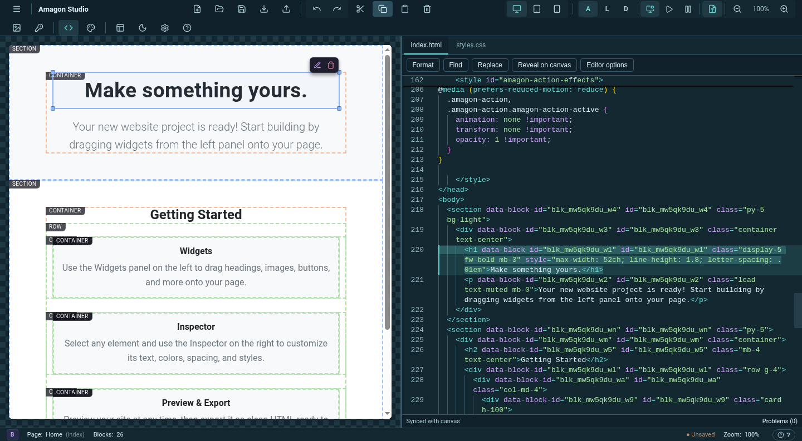
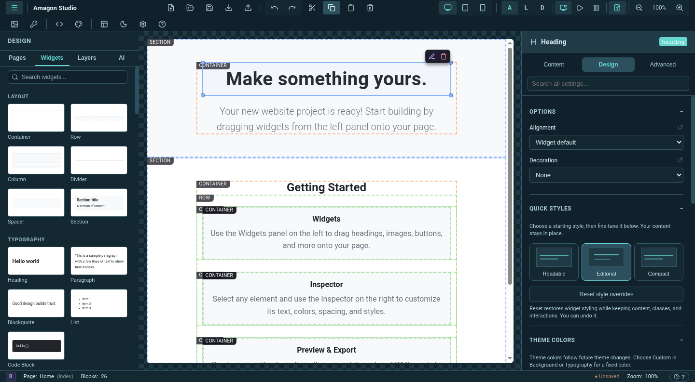
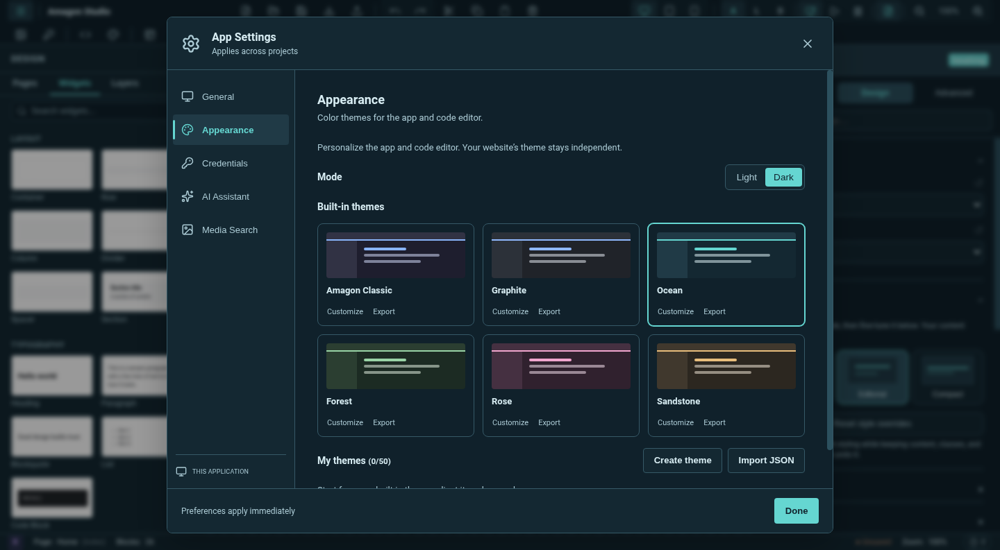
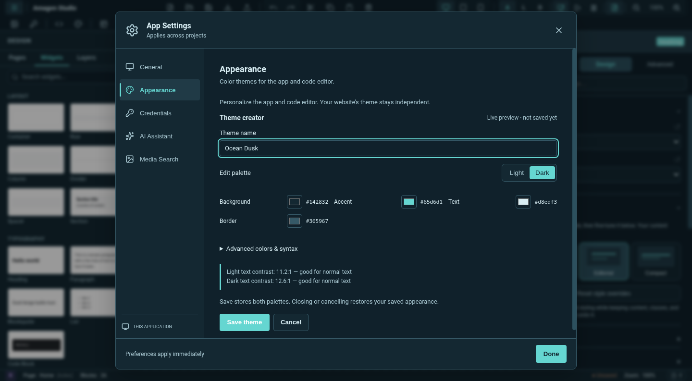

Amagon 1.11.0 makes the whole editor easier to shape around the way you work: clearer controls for every widget, built-in and custom app themes, and a canvas that connects directly to your code.

## Make every widget yours

All 63 widgets now share a searchable **Content / Design / Advanced** inspector. Start with a design preset, adjust spacing, typography, colors and layout, then reset individual values or style overrides without losing your content. Collapsible sections keep the controls manageable on smaller screens.

## Six themes, plus your own

Choose **Classic, Graphite, Ocean, Forest, Rose, or Sandstone** in App Settings → Appearance. Each has a light and dark palette, and the code editor follows along. Your website’s colors remain independent.

Create a theme from any starting palette, preview changes live, check text contrast, and adjust advanced interface and syntax colors. Save, duplicate, rename, import, or export your themes as JSON.

## Canvas on the left, code on the right

The new **Canvas + Code** layout gives both views their own resizable space. Click a widget in the canvas to switch to HTML, scroll to its opening tag, and highlight its complete markup—even when you click the same widget again.

The code editor also gains local, offline loading; HTML and CSS formatting; find and replace; clickable diagnostics; editor preferences; and page-specific drafts that survive switching tabs. A small model cache and an off-by-default minimap keep the experience light.

## Updated dependencies

Compatible upstream updates refresh the editor and its bundled preview/export assets. Bundled fonts and icons also load correctly through the desktop asset protocol. The npm audit is clear for both development and production dependencies, and font catalog generation no longer installs an unused CLI dependency chain.

## Archive compatibility

Archive loading now supports older Node 22 runtimes consistently. Cross-platform fixture and network-test improvements bring the full suite to **1,146 passing tests**.

## Downloads

| Platform | Download |
| --- | --- |
| Windows x64 | [Windows installer](https://github.com/Shin-Aska/amagon-html-editor/releases/download/v1.11.0/Amagon-HTML-Editor-Setup-1.11.0.exe) |
| Linux x64 | [AppImage](https://github.com/Shin-Aska/amagon-html-editor/releases/download/v1.11.0/Amagon-HTML-Editor-1.11.0.AppImage) · [Debian / Ubuntu](https://github.com/Shin-Aska/amagon-html-editor/releases/download/v1.11.0/hoarses-html-editor_1.11.0_amd64.deb) |

[SHA-256 checksums](https://github.com/Shin-Aska/amagon-html-editor/releases/download/v1.11.0/SHA256SUMS.txt)

macOS binaries are not included in this release.

**Full changelog:** [v1.10.1 → v1.11.0](https://github.com/Shin-Aska/amagon-html-editor/compare/v1.10.1...v1.11.0)

**Feature review:** [PR #20](https://github.com/Shin-Aska/amagon-html-editor/pull/20) · [Validation report](https://github.com/Shin-Aska/amagon-html-editor/blob/main/docs/releases/1.11.0/validation.md)
