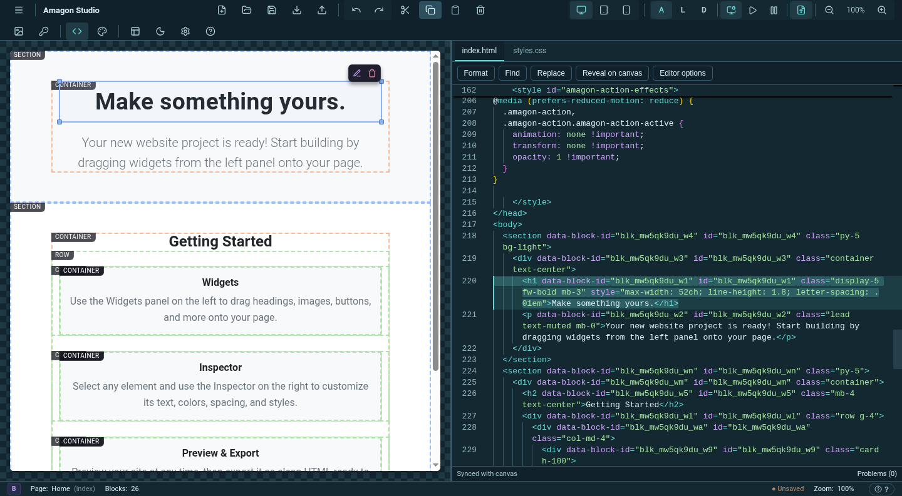
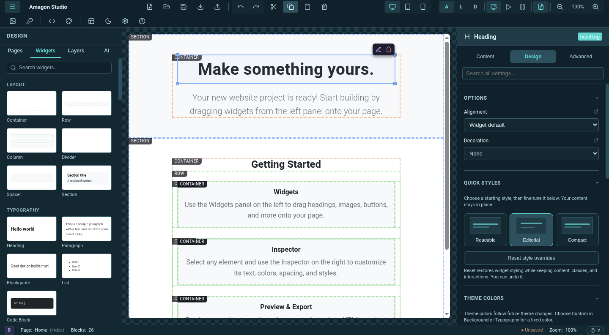
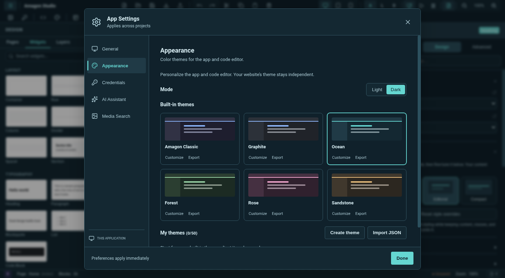
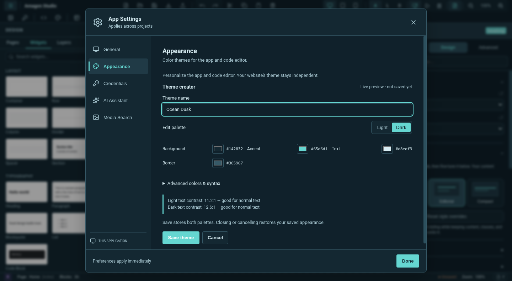
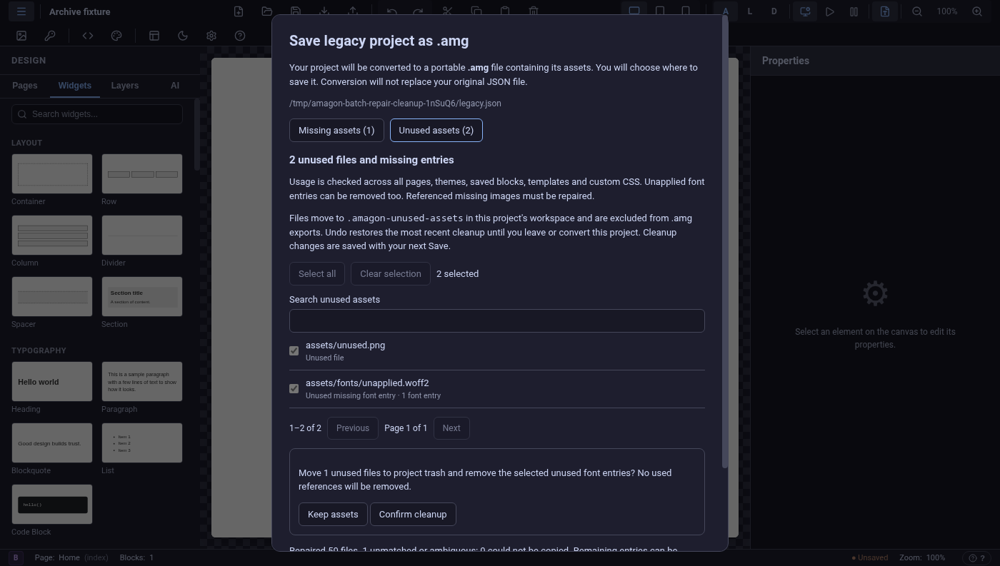
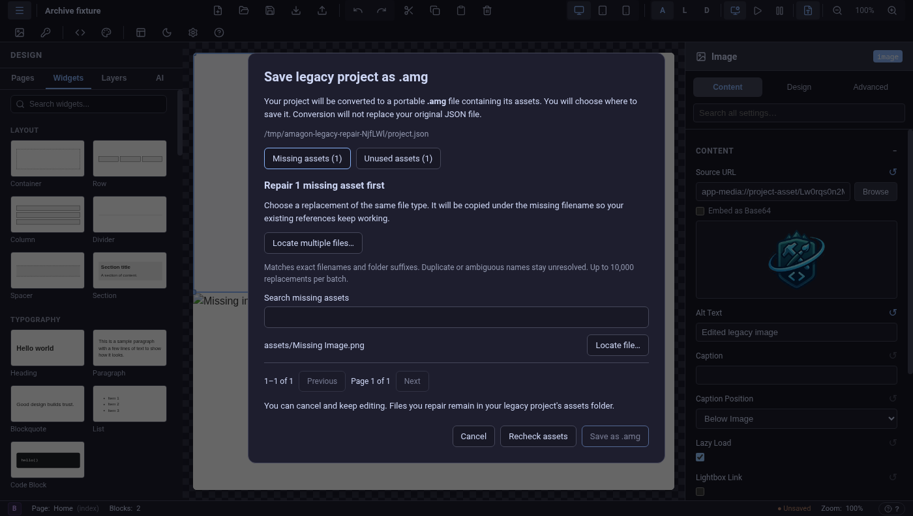

Amagon 1.11.1 brings clearer controls for every widget, built-in and custom app themes, a canvas that connects directly to your code, and reliable project asset handling.

## Make every widget yours

All 63 widgets now share a searchable **Content / Design / Advanced** inspector. Start with a design preset, adjust spacing, typography, colors and layout, then reset individual values or style overrides without losing your content. Collapsible sections keep the controls manageable on smaller screens.

## Six themes, plus your own

Choose **Classic, Graphite, Ocean, Forest, Rose, or Sandstone** in App Settings → Appearance. Each has a light and dark palette, and the code editor follows along. Your website’s colors remain independent.

Create a theme from any starting palette, preview changes live, check text contrast, and adjust advanced interface and syntax colors. Save, duplicate, rename, import, or export your themes as JSON.

## Canvas on the left, code on the right

The new **Canvas + Code** layout gives both views their own resizable space. Click a widget in the canvas to switch to HTML, scroll to its opening tag, and highlight its complete markup—even when you click the same widget again.

Rapid file switching also handles background symbol-highlighting cancellations cleanly.

The code editor also gains local, offline loading; HTML and CSS formatting; find and replace; clickable diagnostics; editor preferences; and page-specific drafts that survive switching tabs. A small model cache and an off-by-default minimap keep the experience light.

## Updated dependencies

Compatible upstream updates refresh the editor and its bundled preview/export assets. Bundled fonts and icons also load correctly through the desktop asset protocol. The npm audit is clear for both development and production dependencies, and font catalog generation no longer installs an unused CLI dependency chain.

## Archive compatibility

Archive loading now supports older Node 22 runtimes consistently. Cross-platform fixture and network-test improvements keep archive checks compatible across supported systems.

## Repair and save legacy projects

Legacy JSON projects open even when a referenced asset is missing. Choosing **Save** or **Save As** opens a guided conversion dialog that explains the `.amg` format and lists any missing files.

Use **Locate file** to choose a replacement—even one with a different filename—or restore files yourself and choose **Recheck assets**. Conversion stays disabled until all references are valid. Then choose where to save the `.amg`; conversion preserves your original JSON and includes the full asset library, including unused imports. Cancel keeps your edits and repaired files available.

Large missing-asset sets now have searchable, paginated lists and **Locate multiple files** for batches of up to 10,000 replacements. Matching folder suffixes or unique filenames are repaired without overwriting existing assets; ambiguous names stay available for manual repair.

**Unused assets** reviews both unused files and missing font entries that were never applied. Select what to clean up, review the counts, and confirm. Files move into project trash, and **Undo cleanup** restores files and metadata before you leave or convert the project. The same review is available in **Asset Manager**. Usage checks cover all pages, themes, saved blocks, templates, and CSS, while uncertain dynamic references are kept.

Save validation now inventories nested media, fonts, and other project assets correctly. Conversion after an asset import and legacy autosave also adopts the new bundle without falsely reporting a stale save.

## Reliable image and video imports

Media imports now preserve filenames containing spaces, Unicode, `#`, and literal `%` characters. This fixes percent-encoding errors shown after a file had already been copied, and incorrect returned URLs for filenames containing sequences such as `%20` or `%2F`.

The correction applies to Asset Manager imports and the image, single-image, and video pickers. Imported files remain available after saving and reopening the project.

## Reliable font imports and exports

Imported fonts with spaces or percent characters now Save and reopen correctly. Reopened font files can be deleted, and exported sites include the original font bytes with safe, distinct filenames. Empty layout widgets also retain correctly sized library previews.

## Downloads

| Platform | Download |
| --- | --- |
| Windows x64 | [Windows installer](https://github.com/Shin-Aska/amagon-html-editor/releases/download/v1.11.1/Amagon-HTML-Editor-Setup-1.11.1.exe) |
| Linux x64 | [AppImage](https://github.com/Shin-Aska/amagon-html-editor/releases/download/v1.11.1/Amagon-HTML-Editor-1.11.1.AppImage) · [Debian / Ubuntu](https://github.com/Shin-Aska/amagon-html-editor/releases/download/v1.11.1/hoarses-html-editor_1.11.1_amd64.deb) |

[SHA-256 checksums](https://github.com/Shin-Aska/amagon-html-editor/releases/download/v1.11.1/SHA256SUMS.txt)

macOS binaries are not included in this release.

**Full changelog:** [v1.10.1 → v1.11.1](https://github.com/Shin-Aska/amagon-html-editor/compare/v1.10.1...v1.11.1)

**Feature review:** [PR #20](https://github.com/Shin-Aska/amagon-html-editor/pull/20) · [Validation report](https://github.com/Shin-Aska/amagon-html-editor/blob/main/docs/releases/1.11.1/validation.md)
